# Análisis, valoración y tratamiento del riesgo

Esta guía desarrolla los conceptos necesarios para valorar riesgos, priorizar decisiones y definir tratamientos con evidencia de cierre. Consulten las secciones correspondientes a cada paso de la actividad.

```toc
```

## Escenarios que exigen una decisión

En la Lección 07 se definieron alcance, escalas, tolerancias y propietarios. En la Lección 08 se eligió el método de trabajo. En la Lección 09 se inventariaron activos y se redactaron escenarios sin asignarles nivel. Ahora corresponde **analizar**, **valorar** y **tratar** esos escenarios.

> ¿Qué tan probable y grave es cada riesgo, qué requiere atención primero y qué evidencia permitirá demostrar que el tratamiento funcionó?

Cinco ideas ordenan la lección:

1. la escala se aplica como fue definida; no se reemplazan sus descriptores por intuiciones o por CVSS;
2. el producto de probabilidad e impacto ayuda a ordenar, pero no decide por sí solo;
3. un control reduce el riesgo residual actual solo si existe y hay evidencia de que opera;
4. escribir una acción no reduce el riesgo: el residual esperado es una meta condicionada a implementar y verificar;
5. aceptar un riesgo es una decisión informada del propietario con autoridad, no del técnico que ejecuta el control.

## 1. Análisis, valoración y tratamiento

| Etapa | Pregunta | Producto |
| --- | --- | --- |
| Identificación (L09) | ¿Qué podría ocurrir, por qué, sobre qué activo y con qué consecuencia? | Escenarios y controles existentes |
| **Análisis** | ¿Qué probabilidad e impacto tiene cada escenario? ¿Qué incertidumbre existe? | Estimaciones justificadas y confianza |
| **Valoración** | ¿Cómo se compara con tolerancias, requisitos y otros riesgos? | Prioridades y decisiones necesarias |
| **Tratamiento** | ¿Qué respuesta se elegirá y cómo se comprobará? | Acciones, responsables, plazos, evidencia y residual esperado |
| Revisión del tratamiento | ¿Se implementó la acción y qué riesgo permanece? | Evidencia de cierre, riesgo residual y fecha de revisión |

Asignar `P × I` pertenece al análisis. Decidir qué va primero pertenece a la valoración. Confundir ambas etapas convierte el color de una matriz en una autorización automática.

El proceso no termina al escribir el plan: la revisión vuelve a abrir el análisis cuando la evidencia cambia el estado de un control o del escenario.

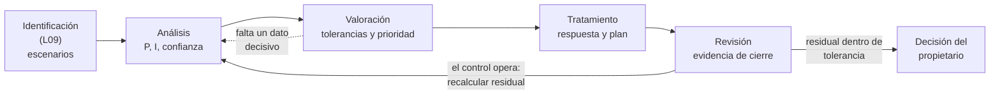

| Pregunta que se responde | Etapa | Error típico si se adelanta |
| --- | --- | --- |
| «¿Cuántas veces ocurrió y cuánto costaría?» | Análisis | Estimar la consecuencia pensando en la solución propuesta |
| «¿Cuál va primero?» | Valoración | Ordenar solo por color sin revisar tolerancias |
| «¿Qué haremos y cómo sabremos que funcionó?» | Tratamiento | Proponer acciones sin evidencia de cierre |
| «¿Qué quedó y quién lo asume?» | Revisión | Declarar cerrado el riesgo porque se cerró el ticket |

## 2. Una escala es un acuerdo previo

Una escala traduce información imperfecta a categorías comparables. Debe definirse **antes** de conocer el resultado y mantenerse durante todo el ejercicio.

### Probabilidad del caso PACÍFICO RETAIL

| Nivel | Descriptor para 24 meses |
| ---: | --- |
| 1 | Cero ocurrencias y la condición necesaria no está presente |
| 2 | Cero ocurrencias, pero existe una condición que hace posible el escenario |
| 3 | Una ocurrencia |
| 4 | Entre dos y nueve ocurrencias |
| 5 | Diez o más ocurrencias, o el escenario está ocurriendo al valorar |

En esta lección, «la condición está activa» del nivel 5 significa que **el escenario está ocurriendo**, no que exista una vulnerabilidad sin explotación observada. Si hay una condición técnica pero ninguna ocurrencia, se contrasta primero con el nivel 2. Si los datos no permiten distinguirlo, se registra el supuesto y una confianza baja.

El descriptor se elige recorriendo las preguntas en orden; no se salta al nivel que «parece» adecuado:

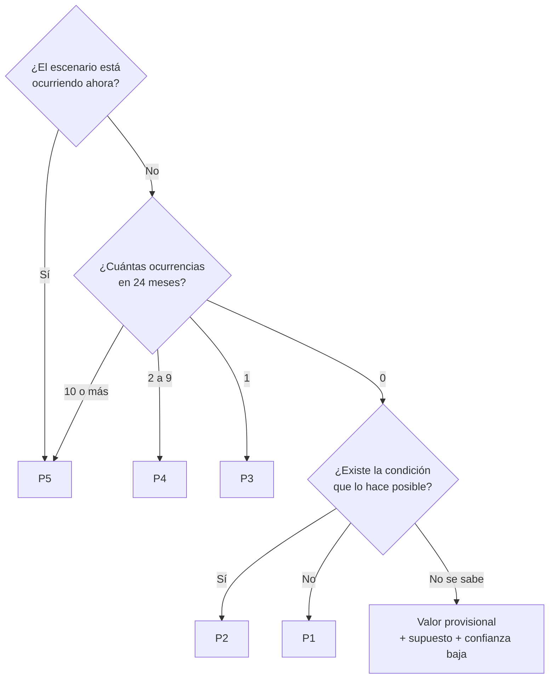

> «Nunca ha fallado» no equivale a cero ocurrencias si **nunca se ha probado**: la ausencia de registro puede reflejar falta de observación. Ese matiz se anota en la confianza.

### Impacto financiero del caso

| Nivel | Consecuencia estimada |
| ---: | ---: |
| 1 | Menos de 5 millones de pesos |
| 2 | Desde 5 y menos de 20 millones |
| 3 | Desde 20 y menos de 50 millones |
| 4 | Desde 50 y menos de 150 millones |
| 5 | Desde 150 millones |

El impacto se estima para la consecuencia **si el escenario ocurre**. La cifra no se usa también como probabilidad. Cuando hay varias consecuencias —financiera, legal, operativa o reputacional— se aplica el criterio acordado: por ejemplo, el máximo relevante o una escala multidimensional definida previamente. No se inventa una regla después de mirar el resultado.

## 3. Aplicar la escala sin mezclarla

Para cada riesgo se conserva la cadena de razonamiento:

```text
escenario -> evidencia o supuesto -> descriptor de P -> descriptor de I
          -> cálculo -> banda -> confianza -> dato faltante
```

Ejemplo:

```text
Antecedente: una interrupción en 24 meses.
Descriptor: P=3.
Consecuencia estimada: 80 millones.
Descriptor: I=4.
Resultado académico: 3 × 4 = 12, banda alta.
Confianza: media; falta conocer la causa y el desempeño posterior.
```

### Qué no debe mezclarse

| Dato disponible | Uso correcto | Uso incorrecto |
| --- | --- | --- |
| CVSS 9,8 | Severidad técnica de una vulnerabilidad | Copiarlo como impacto, probabilidad o nivel del negocio |
| EPSS | Señal de probabilidad de explotación de una vulnerabilidad | Tratarlo como probabilidad completa del escenario empresarial |
| Tres incidentes | Aplicar el descriptor de frecuencia acordado | Convertirlos en «60 %» sin modelo ni base estadística |
| Pérdida de 80 millones | Aplicar el intervalo de impacto | Usarla para afirmar que el evento es frecuente |
| Opinión de un experto | Registrar juicio, fundamento y confianza | Presentarla como hecho observado |

## 4. La matriz 5 × 5

En la actividad se usa una convención académica:

```text
nivel = probabilidad × impacto
```

| Producto | Banda de visualización |
| ---: | --- |
| 1 a 4 | Bajo |
| 5 a 9 | Moderado |
| 10 a 16 | Alto |
| 17 a 25 | Crítico |

Siempre se conserva el par. `2 × 5` y `5 × 2` producen 10, pero no cuentan la misma historia:

- `2 × 5`: evento poco frecuente o condicionado, con consecuencia extrema;
- `5 × 2`: evento frecuente o activo, con consecuencia acotada.

El tratamiento puede ser distinto aunque el color sea el mismo.


Observen en la matriz que:

- las bandas no forman líneas rectas: `4 × 4 = 16` es alto, pero `4 × 5 = 20` ya es crítico;
- la columna I5 nunca baja de moderado: una consecuencia extrema mantiene atención aunque el evento sea raro;
- V-02 y V-03 comparten celda, pero V-03 es **provisional**: la posición puede cambiar cuando se confirme la condición.

### Límite matemático

Los niveles 1 a 5 son categorías ordinales: indican orden, pero no prueban que 4 sea exactamente el doble de 2. Multiplicarlos es una convención útil para visualizar y comparar bajo las reglas acordadas, no una medición exacta ni una probabilidad monetaria.

Por eso la matriz:

- no autoriza automáticamente aceptar un riesgo;
- no reemplaza tolerancias ni requisitos obligatorios;
- no suma riesgos sin un método de agregación;
- no demuestra precisión por mostrar números;
- no elimina la incertidumbre de los datos de entrada.

## 5. Riesgo inherente, residual actual y residual esperado

| Concepto | Momento de la estimación | Controles considerados |
| --- | --- | --- |
| Riesgo inherente | Antes de evaluar controles | Ninguno |
| Riesgo residual actual | Situación al día de la evaluación | Solo controles implementados cuya operación tiene evidencia |
| Riesgo residual esperado | Estado objetivo después del plan | Controles propuestos, únicamente como condición futura |

Ejemplo:

```text
Inherente: P4 × I4 = 16.
Control declarado: respaldo diario.
Evidencia: no hay prueba de restauración.
Residual actual: no se reduce solo por existir copias.
Plan: ejecutar restauración completa y medir tiempo y pérdida de datos.
Residual esperado: se recalcula únicamente si la prueba acredita la reducción.
```

Un residual esperado no se presenta como un hecho. Se escribe «podría reducirse a… si se implementa y verifica…».

El mismo riesgo pasa por estados distintos; solo la verificación convierte una meta en el nuevo residual actual:

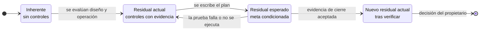

Escribir el plan **no** mueve el riesgo de estado: el residual actual sigue siendo el mismo hasta que la evidencia de cierre se revisa.

## 6. Diseño y operación del control

Dos preguntas evitan bajar el riesgo por controles que solo existen en el papel:

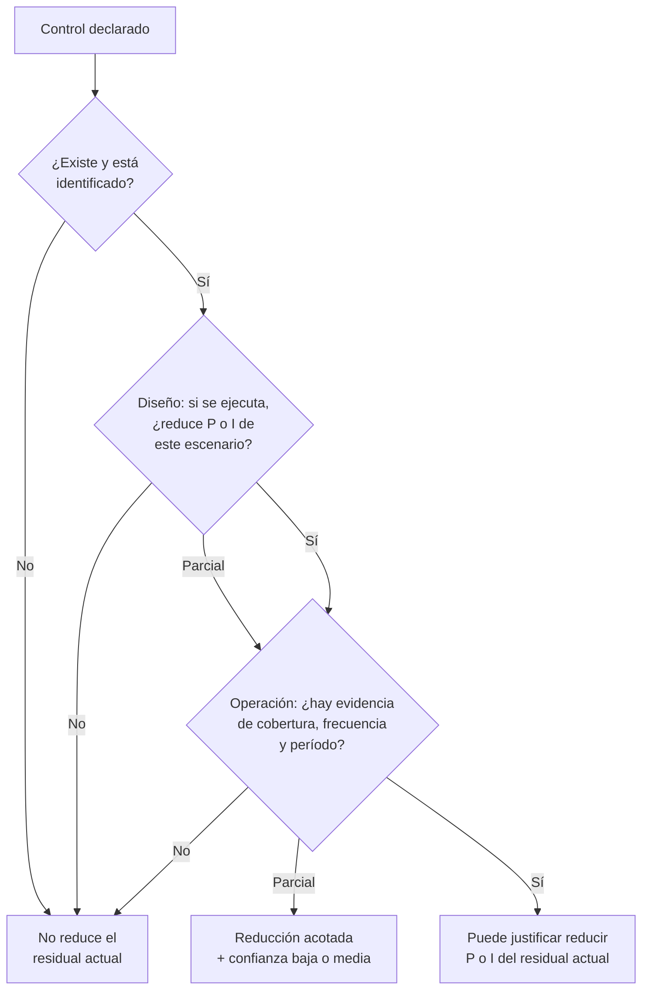

| Dimensión | Pregunta | Evidencia posible |
| --- | --- | --- |
| Diseño | Si se ejecuta como fue pensado, ¿el control reduce este escenario? | Arquitectura, procedimiento, regla, segregación de funciones |
| Operación | ¿Se ejecuta con cobertura y frecuencia suficientes? | Configuración exportada, registros, muestreo, prueba, acta, ticket cerrado |

### Ejemplos

| Control declarado | Problema de diseño u operación | Lectura para el residual actual |
| --- | --- | --- |
| «Se cierran cuentas al recibir un correo» | No hay plazo, conciliación ni escalamiento | Los casos tardíos demuestran que la operación es insuficiente |
| «Hay respaldo diario» | La copia no garantiza restauración | Sin prueba no se acredita disponibilidad recuperable |
| «El sistema está parchado» | Solo existe una declaración verbal | Mantener incertidumbre hasta revisar evidencia aplicable |
| «El proveedor tiene contrato» | No contiene tiempo máximo ni evidencia de recuperación | El contrato no reduce la consecuencia esperada |
| «Hay contraseña» | Puede ser insuficiente para una cuenta privilegiada | Evaluar MFA, origen, privilegios y revisión de uso |

La evidencia debe corresponder al control, al activo, al período y al riesgo analizado. Una captura de pantalla aislada puede mostrar una configuración, pero no necesariamente su cobertura ni operación sostenida.

## 7. Incertidumbre y confianza

Una cifra sin calidad de evidencia puede parecer más segura de lo que es. La ficha conserva:

- **confianza**: alta, media o baja según evidencia, consistencia y actualidad;
- **supuesto**: afirmación provisional usada para poder estimar;
- **dato faltante**: información concreta que podría cambiar la decisión;
- **sensibilidad**: qué ocurre si P o I cambia un nivel.

### Criterios para asignar la confianza

La confianza califica la **calidad del dato**, no la gravedad del riesgo. Un riesgo crítico puede tener confianza baja y uno bajo, confianza alta.

| Confianza | Evidencia típica | Ejemplo |
| --- | --- | --- |
| Alta | Registros completos, recientes y consistentes entre fuentes; prueba ejecutada | Exportación de configuración más prueba positiva y negativa del mismo mes |
| Media | Evidencia real pero incompleta, antigua o de una sola fuente | Tres incidentes registrados, sin conocer su causa ni privilegios afectados |
| Baja | Declaración verbal, supuesto sin verificar o dato del que depende la existencia de la condición | «El proveedor dice que ya parchó», sin versión ni prueba |

Una forma breve de redactarla:

```text
Confianza media: [qué evidencia existe]; falta [dato concreto] que podría mover [P o I] a [nivel].
```

### Riesgo provisional

Si una condición todavía no está confirmada, hay dos formas defensibles:

1. asignar un valor provisional y marcarlo claramente;
2. presentar ramas condicionadas: «si la condición existe… / si no existe…».

Lo incorrecto es convertir la duda en certeza por asignarle un número. Validar un parche o la pertenencia de una dirección IP tampoco mitiga: primero determina cuál es el estado real y luego se decide el tratamiento.

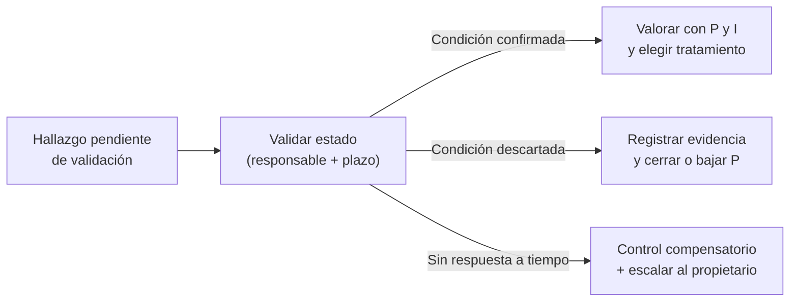

## 8. El producto no decide solo

La valoración compara el resultado con el contexto acordado. Dos riesgos empatados se distinguen por:

| Criterio | Pregunta |
| --- | --- |
| Tolerancia | ¿La consecuencia supera un límite explícito del negocio? |
| Requisito | ¿Existe una obligación legal, contractual o institucional no negociable? |
| Urgencia | ¿Hay una fecha límite, campaña o congelamiento de cambios? |
| Dependencia | ¿Afecta varios procesos o controles de recuperación a la vez? |
| Exposición | ¿La condición está accesible y el evento tiene señales recientes? |
| Incertidumbre | ¿Falta un dato que puede cambiar materialmente la decisión? |
| Factibilidad | ¿El tratamiento puede ejecutarse a tiempo y con recursos disponibles? |
| Efecto acumulativo | ¿Varios riesgos comparten causa o podrían ocurrir juntos? |

Una forma ordenada de aplicar esos criterios es filtrar primero lo no negociable y usar el producto después:

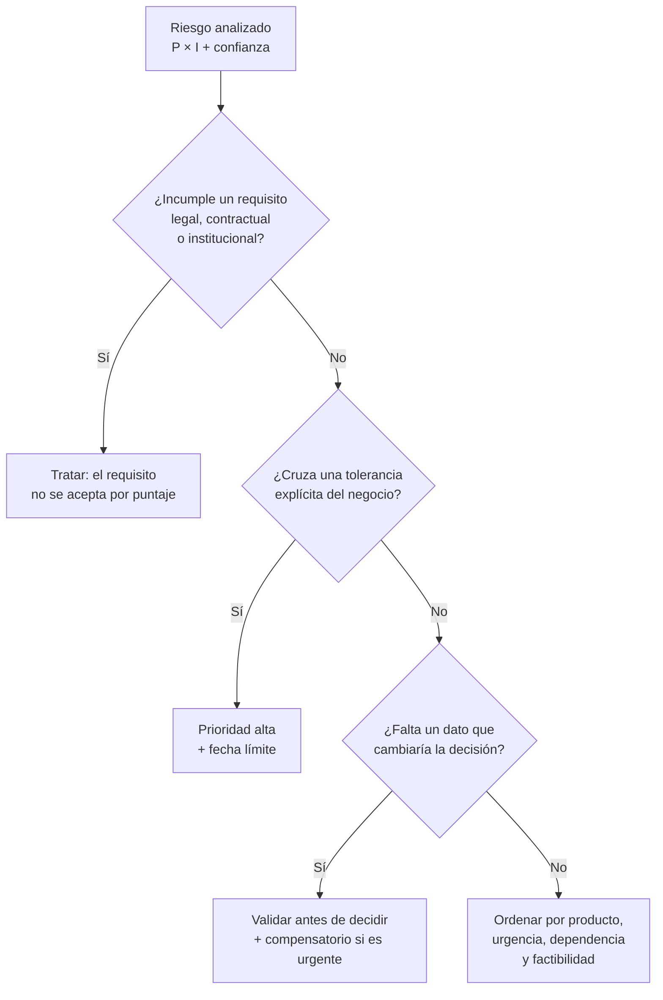

Un riesgo con producto 10 puede ser prioritario frente a uno de 12 si cruza una tolerancia de recuperación antes de una fecha crítica. La decisión debe explicar ese razonamiento; no se cambia la escala para hacer que el número confirme una prioridad ya elegida.

### Requisitos mínimos

Una obligación de proteger datos personales o cumplir una condición contractual no desaparece por quedar en banda baja. La matriz informa la urgencia y el tratamiento; no autoriza incumplir un requisito.

## 9. Resolver empates con análisis de sensibilidad

El análisis de sensibilidad cambia **un supuesto a la vez**:

```text
Valor original: P3 × I4 = 12.
Cambio: evidencia nueva reduce P de 3 a 2.
Nuevo resultado: P2 × I4 = 8.
Decisión: comprobar si deja de superar la tolerancia o si permanece obligatorio tratarlo.
```

Sirve para identificar qué dato tiene valor decisional. Si cambiar P un nivel no altera la respuesta, quizá no convenga retrasar una acción urgente para obtener una precisión innecesaria. Si cambia aceptación por tratamiento, ese dato debe validarse antes de decidir.

No se cambian P e I simultáneamente: no se sabría qué supuesto produjo el efecto.

| Resultado de la prueba | Lectura | Qué hacer |
| --- | --- | --- |
| El producto cambia, pero la banda y la prioridad no | La decisión es **robusta** frente a ese dato | Actuar; no retrasar por precisión innecesaria |
| La banda cambia, pero la prioridad no | El dato afecta la comunicación, no la decisión | Registrar la sensibilidad en la ficha |
| La prioridad o la respuesta cambian | El dato tiene **valor decisional** | Validarlo antes de aceptar; si urge, usar un compensatorio |

## 10. Elegir una respuesta al riesgo

| Respuesta | Qué hace | Ejemplo | Advertencia |
| --- | --- | --- | --- |
| Evitar | Elimina la actividad que origina el riesgo | Retirar un servicio que no puede operar dentro de la tolerancia | Puede eliminar también un beneficio del negocio |
| Mitigar | Reduce probabilidad o impacto mediante controles | MFA, restricción de origen, restauración probada | Debe verificarse el efecto; instalar no equivale a funcionar |
| Compartir o transferir | Distribuye consecuencias mediante contrato, seguro o tercero | Cobertura contractual y nivel de servicio | No elimina obligaciones ni toda responsabilidad interna |
| Aceptar | Asume el residual de forma consciente | Excepción documentada dentro de autoridad y tolerancia | Requiere propietario, fundamento y fecha de revisión |

Una respuesta puede combinarse: mitigar de inmediato con un control compensatorio, transferir parte de la consecuencia mediante contrato y aceptar el residual que permanece.

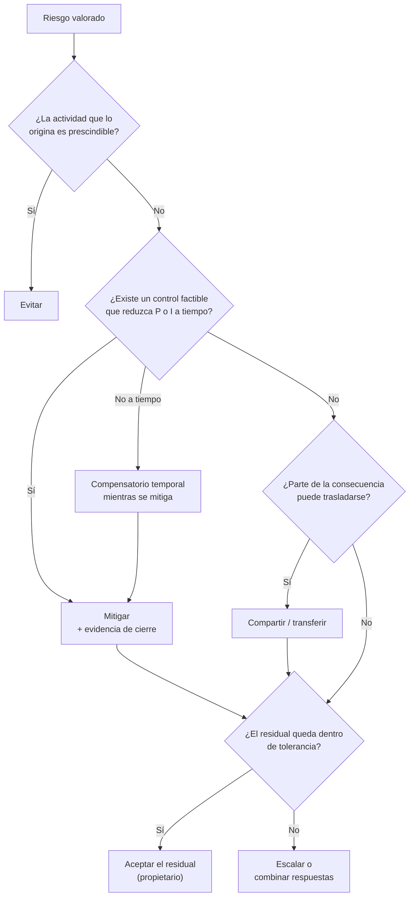

El diagrama es una ayuda de razonamiento, no un algoritmo: un requisito obligatorio puede impedir aceptar aunque el residual parezca bajo.

## 11. Un plan de tratamiento verificable

Una acción como «actualizar», «poner MFA» o «hablar con el proveedor» no es un plan. Cada fila debe contener:

| Campo | Contenido esperado |
| --- | --- |
| Riesgo relacionado | ID y escenario que se pretende modificar |
| Estado de entrada | Confirmado, provisional o pendiente de validación |
| Respuesta | Evitar, mitigar, compartir/transferir o aceptar |
| Acción | Cambio concreto y acotado |
| Control compensatorio | Medida temporal mientras se completa la acción principal |
| Responsable de ejecutar | Cargo que realiza o coordina la tarea |
| Propietario del riesgo | Cargo con autoridad sobre la consecuencia y el residual |
| Plazo y dependencia | Fecha, prerrequisitos, ventana y escalamiento |
| Evidencia de cierre | Resultado observable que demostrará implementación y operación |
| Residual esperado | Estimación condicionada a la evidencia y fecha de revisión |

### Ejemplo de fila completa

Una fila débil y una fila verificable para el mismo riesgo:

```text
Débil:  V-02 | Mitigar | Poner MFA | TI | Pronto | MFA activo | Bajo
```

```text
Riesgo relacionado:   V-02 - órdenes falsas desde correo sin MFA
Estado de entrada:    Confirmado: autenticación heredada habilitada; sin abuso observado
Respuesta:            Mitigar
Acción:               Deshabilitar autenticación heredada y exigir MFA a todas
                      las cuentas de correo corporativo
Compensatorio:        Alerta por inicio de sesión desde país no habitual hasta
                      completar la cobertura (caduca al cierre)
Responsable:          Jefatura de TI
Propietario:          Gerencia de operaciones
Plazo y dependencia:  10 días hábiles; requiere comunicar a usuarios y ventana de cambio
Evidencia de cierre:  Exportación de políticas, 100 % de cuentas cubiertas,
                      prueba de acceso heredado rechazado y acceso con MFA aceptado
Residual esperado:    Podría bajar P de 2 a 1 si la cobertura es total y se
                      monitorea; I se mantiene en 5. Revisión: 30 días.
```

### Responsable no es propietario

TI puede configurar MFA, pero una gerencia propietaria decide si el riesgo residual es tolerable. Un proveedor puede ejecutar una restauración, pero no aceptar el riesgo empresarial en nombre de la organización. Una herramienta nunca tiene autoridad.

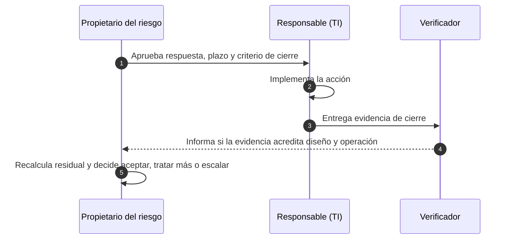

El verificador puede ser auditoría interna, otra área técnica o el mismo equipo con una revisión cruzada; lo importante es que quien ejecuta no sea el único que declara el cierre.

### El control compensatorio

Cuando la acción definitiva no cabe antes de una fecha crítica, se diseña una medida temporal: restringir origen, aumentar monitoreo, aplicar doble aprobación o aislar una función. Debe tener responsable, caducidad y prueba. «Temporal» no significa informal ni permanente por olvido.

## 12. Evidencia de cierre

El cierre se define antes de implementar. Debe demostrar algo observable:

| Acción | Evidencia débil | Evidencia de cierre útil |
| --- | --- | --- |
| Habilitar MFA | Captura de una cuenta | Exportación de configuración, cobertura total y pruebas positiva/negativa |
| Aplicar parche | Ticket que dice «instalado» | Versión o archivos verificados, aplicabilidad, prueba y aprobación del cambio |
| Mejorar respaldos | Informe de copia exitosa | Restauración completa, tiempo medido, pérdida medida y acta |
| Cerrar cuentas | Procedimiento actualizado | Conciliación de bajas, tiempos de desactivación y excepciones revisadas |
| Mejorar proveedor | Contrato firmado | Nivel de servicio, evidencia de prueba y mecanismo de escalamiento |

Cerrar una tarea no cierra automáticamente el riesgo. Después de verificar el control se recalcula el residual y el propietario toma la decisión.

## 13. Riesgo residual y aceptación

El riesgo residual rara vez es cero. Un control puede:

- reducir la probabilidad sin cambiar el impacto;
- reducir el impacto sin impedir el evento;
- desplazar parte de la consecuencia a un tercero;
- introducir dependencias o riesgos nuevos.

Una aceptación completa registra:

```text
riesgo y residual -> evidencia disponible -> tolerancia aplicable
-> propietario que decide -> condiciones -> fecha de revisión
-> hecho o umbral que obliga a reabrir
```

El implementador informa. El propietario acepta. Si el residual supera la autoridad o tolerancia del propietario, se escala.

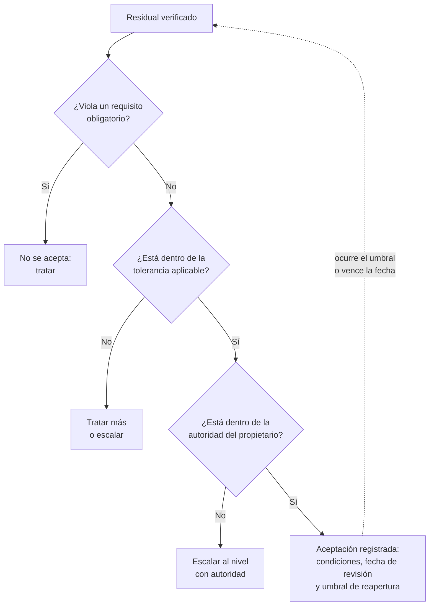

### Hechos que obligan a reabrir

Una aceptación no es permanente. Se define de antemano qué la reabre:

- ocurrencia del escenario o de un incidente cercano;
- cambio del activo, del proveedor o de la arquitectura;
- vencimiento de un control compensatorio;
- nueva información de exposición (por ejemplo, explotación pública de una vulnerabilidad);
- cambio de la tolerancia o de un requisito legal o contractual;
- llegada de la fecha de revisión.

## 14. Ejemplo resuelto - caso VIÑA DEL ESTE (ficticio)

La organización debe priorizar tres escenarios antes de su temporada alta:

| ID | Escenario | Antecedente | Consecuencia |
| --- | --- | --- | ---: |
| V-01 | El proveedor de rastreo interrumpe el servicio y detiene despachos | Una interrupción en 24 meses | 80 millones |
| V-02 | Un atacante usa una cuenta de correo sin MFA y envía órdenes falsas | Sin incidente confirmado; autenticación heredada habilitada | 160 millones |
| V-03 | Una falla de la biblioteca PDF permite alterar datos, si la función vulnerable está disponible | Uso de la función por validar | 220 millones |

Aplicando la escala de esta lección:

| ID | Inherente | Confianza | Control existente y residual actual |
| --- | --- | --- | --- |
| V-01 | `P3 × I4 = 12`, alto | Media; falta causa y desempeño reciente | Contrato sin tiempo máximo: no hay evidencia para reducir |
| V-02 | `P2 × I5 = 10`, alto | Media; la condición existe, no el abuso | Filtro de correo no reemplaza MFA: no hay reducción demostrada |
| V-03 | `P2 × I5 = 10`, alto, provisional | Baja; falta confirmar que la función es alcanzable | Declaración del proveedor sin evidencia: mantener provisional |

### Valoración

V-01 tiene el producto mayor y afecta directamente la continuidad de despachos. V-02 tiene impacto superior y una condición confirmada, por lo que requiere mitigación aunque no haya incidente. V-03 no se declara corregido ni confirmado: primero se valida la función y el parche; mientras tanto puede requerir una restricción compensatoria si la exposición es plausible.

### Plan de referencia

| Riesgo | Acción | Responsable y propietario | Evidencia de cierre | Residual esperado |
| --- | --- | --- | --- | --- |
| V-01 | Probar procedimiento manual y recuperación del servicio antes de temporada | Operaciones ejecuta; Gerencia de operaciones es propietaria | Prueba con tiempo medido y acta | Recalcular P e I después de la prueba |
| V-02 | Deshabilitar autenticación heredada, habilitar MFA y revisar cobertura | TI ejecuta; Gerencia de operaciones es propietaria | Configuración, cobertura total y pruebas positiva/negativa | Reducción condicionada a cobertura y monitoreo |
| V-03 | Confirmar uso de la función y estado del parche; restringir importación mientras se valida | TI consulta; Jefatura de tecnología decide | Evidencia del proveedor, inventario y prueba no destructiva | Dos ramas según condición confirmada o descartada |

### Plan en el tiempo

El orden también depende del calendario: la validación de V-03 debe terminar antes de decidir su tratamiento, y la prueba de V-01 debe ocurrir antes de la temporada alta (fechas ilustrativas).

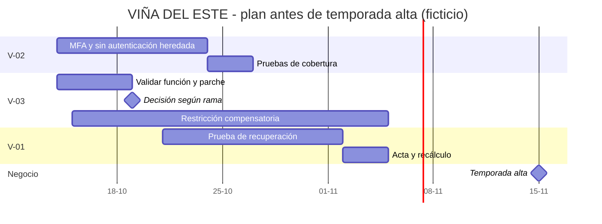

### Rama condicionada de V-03

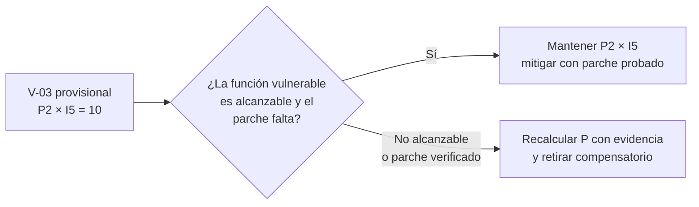

### Conclusión de la etapa

> La matriz ordena los escenarios, pero la prioridad se decide con continuidad, exposición e incertidumbre. V-01 necesita una prueba antes de temporada; V-02 requiere mitigación porque la condición está confirmada; V-03 conserva su estado provisional y no reduce el residual por una declaración sin evidencia. Ninguna acción escrita modifica el residual actual: la reducción se reconocerá después de verificar diseño, cobertura y operación, y el propietario decidirá sobre lo que permanezca.

## 15. Comunicar la decisión

Un cierre ejecutivo no repite la matriz: traduce el análisis a una decisión. Sigue siempre el mismo orden:

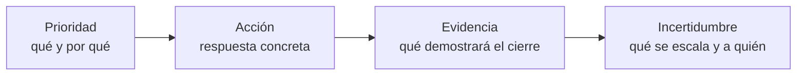

Ejemplo para VIÑA DEL ESTE (72 palabras):

> La primera prioridad es V-01: aunque su producto (12) supera por poco a V-02, una interrupción del rastreo detendría despachos en temporada alta. Proponemos probar el procedimiento manual y la recuperación del servicio antes del 15 de noviembre. El cierre exige una prueba con tiempo medido y acta firmada por Operaciones. Escalamos a Jefatura de tecnología la incertidumbre de V-03: mientras no se confirme el parche, se mantiene la restricción de importación.

| Debe evitarse | Por qué |
| --- | --- |
| «El riesgo es alto, hay que mejorar la seguridad» | No dice qué riesgo, qué acción ni qué evidencia |
| Lista de los seis riesgos con su color | El lector no sabe qué decidir |
| «Con esto el riesgo queda bajo» | Presenta un residual esperado como hecho |
| Omitir la incertidumbre | Oculta el dato que podría cambiar la decisión |

## 16. Errores frecuentes

| Error | Corrección |
| --- | --- |
| Copiar CVSS como nivel del negocio | Aplicar la escala definida a un escenario y sus consecuencias |
| Usar «condición activa» para cualquier vulnerabilidad | Reservarla al escenario que está ocurriendo según la regla del caso |
| Mostrar solo el producto | Conservar `P × I`, evidencia, confianza y dato faltante |
| Bajar residual por un control documentado | Exigir evidencia de diseño y operación |
| Bajar residual por una acción futura | Mantener residual actual; marcar el esperado como condicional |
| Priorizar solo por color | Considerar tolerancia, requisito, dependencia, urgencia e incertidumbre |
| Fijar residual cero | Explicar qué probabilidad o impacto permanece |
| Escribir «actualizar» como mitigación | Agregar alcance, responsable, plazo, prueba y criterio de cierre |
| Hacer que TI acepte el riesgo del negocio | Asignar aceptación al propietario con autoridad |
| Tratar validación como mitigación | La validación determina estado; luego se elige la respuesta |
| Confundir confianza con gravedad | La confianza califica el dato; la gravedad la dan P e I |
| Leer «nunca ha fallado» como P1 | Si nunca se probó, la ausencia de fallas no es evidencia |
| Aceptar sin fecha de revisión ni umbral de reapertura | Registrar condiciones, fecha y hechos que reabren la decisión |

## 17. Preguntas para consultar y repasar

Estas preguntas permiten revisar los conceptos utilizados en la actividad:

1. ¿Qué diferencia hay entre análisis, valoración y tratamiento?
2. ¿Por qué se conserva el par `P × I` además del producto?
3. ¿Qué significa que una escala sea ordinal?
4. ¿Cuándo un control puede reducir el riesgo residual actual?
5. ¿Qué diferencia hay entre residual actual y residual esperado?
6. ¿Cómo se trata un escenario cuya condición todavía no está confirmada?
7. ¿Qué criterios pueden romper un empate en la matriz?
8. ¿Qué diferencia existe entre responsable de ejecutar y propietario del riesgo?
9. ¿Qué debe demostrar una evidencia de cierre?
10. ¿Por qué un riesgo crítico puede tener confianza baja?
11. ¿Qué hechos deberían obligar a reabrir una aceptación?
12. ¿En qué orden se redacta un cierre ejecutivo y por qué?

## 18. Glosario

| Término | Definición |
| --- | --- |
| Aceptación | Decisión informada de asumir un residual bajo condiciones y autoridad definidas. |
| Análisis de sensibilidad | Revisión del efecto de cambiar un supuesto o nivel a la vez. |
| Apetito de riesgo | Cantidad y tipo de riesgo que la organización está dispuesta a perseguir o retener para lograr sus objetivos. |
| Banda | Categoría visual asignada a un rango de productos de la matriz. |
| Confianza | Juicio sobre la calidad, actualidad y consistencia de la evidencia usada. |
| Control compensatorio | Medida temporal que reduce exposición mientras se implementa la solución principal. |
| Evidencia de cierre | Resultado verificable que demuestra implementación y operación de una acción. |
| Impacto | Magnitud de la consecuencia si el escenario ocurre. |
| Probabilidad | Categoría que representa posibilidad o frecuencia según la escala acordada. |
| Propietario del riesgo | Cargo con autoridad y responsabilidad para decidir la respuesta y el residual. |
| Registro de riesgos | Documento que conserva, por riesgo, escenario, estimación, confianza, respuesta, responsables, evidencia y estado. |
| Riesgo inherente | Riesgo estimado sin considerar controles. |
| Riesgo provisional | Estimación condicionada a información todavía no confirmada. |
| Riesgo residual actual | Riesgo que permanece con los controles implementados y acreditados hoy. |
| Riesgo residual esperado | Meta condicionada a implementar y verificar un tratamiento. |
| Tolerancia | Límite de variación que la organización admite respecto de un objetivo. |
| Tratamiento | Proceso de seleccionar e implementar una respuesta al riesgo. |
| Valoración | Comparación de resultados con criterios para decidir prioridades y respuestas. |

## Fuentes

- [NIST SP 800-30 Rev. 1 - Guide for Conducting Risk Assessments](https://csrc.nist.gov/pubs/sp/800/30/r1/final). Probabilidad, impacto, incertidumbre, controles y determinación del riesgo.
- [NIST IR 8286A Rev. 1 - Identifying and Estimating Cybersecurity Risk for Enterprise Risk Management](https://csrc.nist.gov/pubs/ir/8286/a/r1/final). Escenarios, estimación, registro, apetito y tolerancia; revisión final publicada en diciembre de 2025.
- [NIST IR 8286B - Prioritizing Cybersecurity Risk for Enterprise Risk Management](https://csrc.nist.gov/pubs/ir/8286/b/upd1/final). Priorización, selección de respuestas e incorporación de decisiones al registro; actualización final publicada en febrero de 2025.
- [NIST IR 8286 Rev. 1 - Integrating Cybersecurity and Enterprise Risk Management](https://csrc.nist.gov/pubs/ir/8286/r1/final). Integración del riesgo de ciberseguridad con objetivos y gobierno empresarial.
- [NIST IR 8286D - Using Business Impact Analysis to Inform Risk Prioritization and Response](https://csrc.nist.gov/pubs/ir/8286/d/upd1/final). Dependencias, consecuencias empresariales y análisis de impacto para priorizar.
- [NIST Risk Response Glossary](https://csrc.nist.gov/glossary/term/risk_response). Respuestas de aceptar, evitar, mitigar, compartir o transferir.
- [ISO 31000:2018 - Risk management guidelines](https://www.iso.org/standard/65694.html). Principios y proceso general de gestión del riesgo.
- [ISO/IEC 27005:2022 - Guidance on managing information security risks](https://www.iso.org/standard/80585.html). Aplicación del proceso al riesgo de seguridad de la información.

