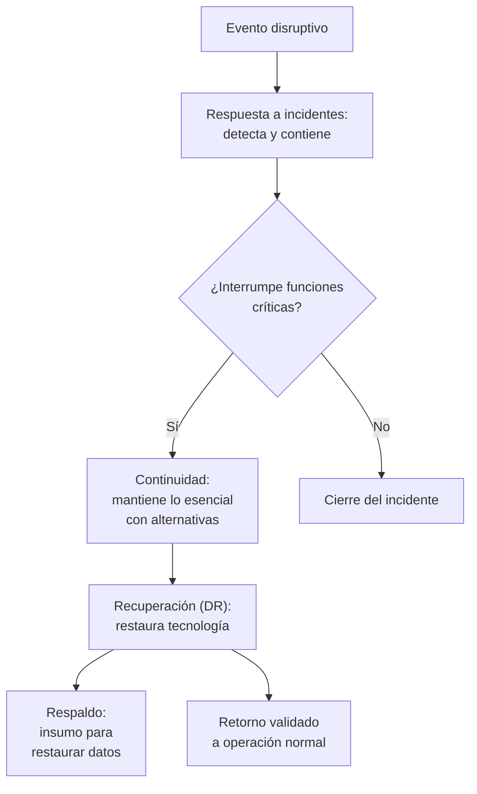
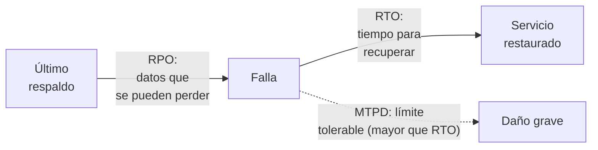
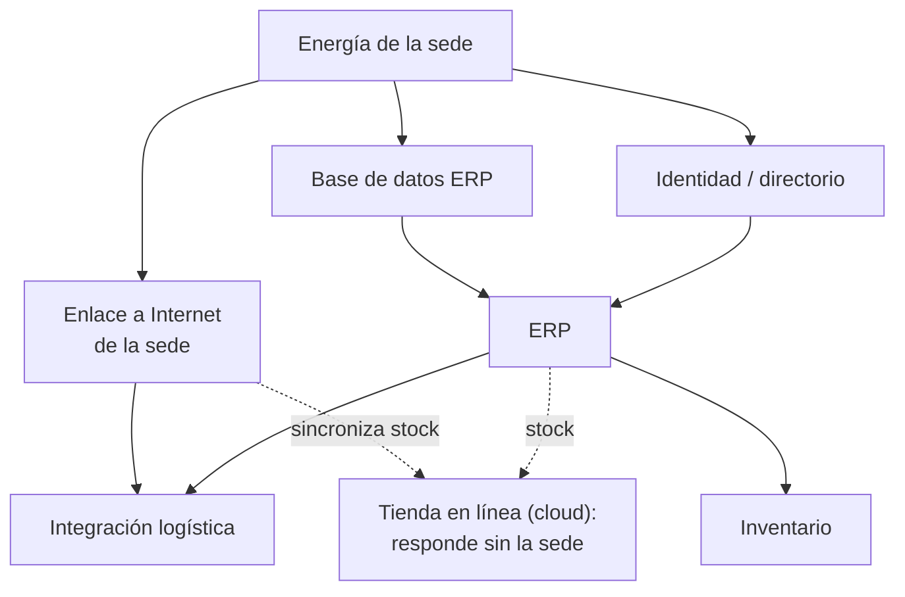
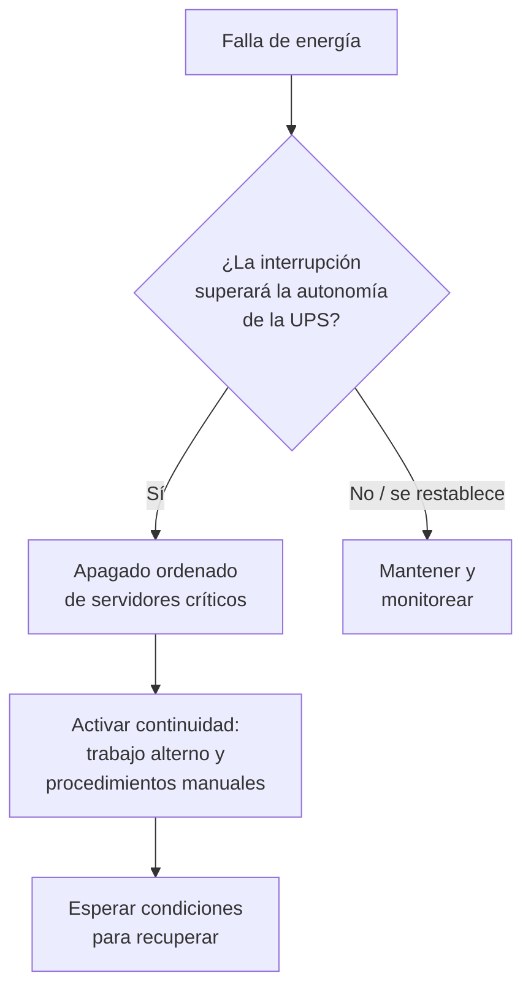

# Recuperación frente a desastres: del evento al plan ejecutable

```toc
```

## De proteger a resistir

La unidad anterior trabajó cómo **reducir** el riesgo: identificar activos, valorar escenarios, elegir controles, redactar políticas. Pero ningún control elimina el riesgo por completo. Tarde o temprano algo falla: un corte de energía, un incendio, un ataque de *ransomware*, la caída de un proveedor. Esta unidad cambia la pregunta.

Ya no es "¿cómo evito que ocurra?", sino:

> Cuando ocurra, ¿cómo sigue funcionando la organización y cómo vuelve a la normalidad sin improvisar?

Cuatro ideas ordenan la lección:

1. **existir no es poder recuperar**: tener un respaldo no demuestra que se pueda restaurar a tiempo;
2. **la prioridad la define el impacto**: no todo vuelve a la vez; primero lo que más duele perder;
3. **las dependencias mandan**: un servicio solo se recupera si lo que necesita ya está disponible;
4. **sin validación no hay retorno**: volver a producción exige probar, no suponer.

## 1. Cuatro conceptos que se confunden

**Contingencia** es el marco general: NIST SP 800-34 llama planificación de contingencia al conjunto de planes con que una organización se prepara para una interrupción. Dentro de ese marco conviven cuatro conceptos. No son sinónimos: cada uno responde una pregunta distinta y se coordinan entre sí. Tres son planes; el cuarto, el respaldo, es un insumo.

| Concepto | Pregunta que responde | Alcance |
| --- | --- | --- |
| **Respuesta a incidentes (IR)** | ¿Qué está pasando y cómo lo contengo? | Detección, contención, erradicación e investigación |
| **Continuidad del negocio (BC)** | ¿Cómo sigo operando lo esencial mientras tanto? | Procesos del negocio y alternativas (manuales, sitio alterno) |
| **Recuperación ante desastres (DR)** | ¿Cómo restauro la tecnología que soporta esos procesos? | Sistemas, datos, infraestructura |
| **Respaldo** | ¿De dónde saco los datos para restaurar? | Copias de datos; es un insumo, no un plan |



El error más común es creer que "tener respaldo" es tener un plan. El respaldo es una pieza; sin estrategia, roles, pruebas y criterios de retorno, es solo una copia.

## 2. Por qué un respaldo no es recuperabilidad

Un respaldo diario demuestra que **existe una copia**. No demuestra:

- **tiempo**: cuánto tarda una restauración completa (podría ser más que el MTPD del proceso);
- **integridad**: que la copia no esté corrupta o incompleta;
- **cobertura**: que incluya todo lo necesario (configuraciones, no solo datos);
- **funcionamiento**: que el sistema restaurado opere y se integre con los demás.

Muchas organizaciones descubren que sus respaldos estaban incompletos o corruptos **recién cuando intentan restaurar** tras un incidente. Por eso la evidencia que vale es la **restauración probada**, con su tiempo medido y su pérdida de datos conocida. "Hay respaldo diario" es una promesa; "restauramos el ERP completo en 3 horas con pérdida de 1 hora de datos, probado el mes pasado" es un hecho.

## 3. Objetivos de tiempo: MTPD, RTO y RPO

Para priorizar se usan tres medidas. Esta lección las presenta; la siguiente (BIA) las calcula en detalle.

| Medida | Qué mide | Pregunta |
| --- | --- | --- |
| **MTPD** | Máximo período tolerable de interrupción | ¿Cuánto puede estar caído un proceso antes de un daño grave? |
| **RTO** | Objetivo de tiempo de recuperación | ¿En cuánto tiempo debe volver el servicio? (menor que el MTPD) |
| **RPO** | Objetivo de punto de recuperación | ¿Cuántos datos recientes se puede permitir perder? |



La relación clave: **RTO < MTPD** (hay que recuperar antes del límite tolerable) y el **RPO define cada cuánto hay que respaldar** (si solo tolero perder 1 hora, no puedo respaldar una vez al día).

## 4. Escenarios de desastre y la política de continuidad

NIST SP 800-34 recomienda planificar por **tipos de escenario**, porque la causa cambia la respuesta:

| Escenario | Ejemplo | Qué estresa |
| --- | --- | --- |
| Pérdida de energía o instalaciones | Corte eléctrico, incendio, inundación | Infraestructura y sitio |
| Pérdida de datos o sistemas | *Ransomware*, borrado, corrupción | Respaldos e integridad |
| Pérdida de personal | Enfermedad masiva, renuncia clave | Conocimiento y roles |
| Pérdida de proveedores | Caída de cloud, corte de un servicio crítico | Dependencias externas |

La **política de continuidad** fija el marco: alcance, objetivos, roles, autoridad para declarar un desastre y compromiso de probar los planes. Sin política, cada incidente se resuelve a criterio de quien esté de turno.

### Estrategias de recuperación

Una estrategia cubre cinco frentes; un plan que olvida uno falla en el peor momento:

| Frente | Preguntas |
| --- | --- |
| Personas | ¿Quién ejecuta? ¿Pueden trabajar remoto? ¿Hay suplentes? |
| Instalaciones | ¿Hay sitio alterno? ¿Con qué equipamiento? |
| Tecnología | ¿Cómo se restauran sistemas y datos? ¿En qué orden? |
| Datos | ¿Dónde está el respaldo? ¿Qué RPO ofrece? ¿Se probó? |
| Proveedores | ¿Qué servicios dependen de terceros? ¿Qué SLA tienen? |

### Sitios alternos

| Tipo | Qué es | Tiempo de puesta en marcha |
| --- | --- | --- |
| Sitio frío (*cold*) | Espacio con energía y red, sin equipos listos | Días |
| Sitio tibio (*warm*) | Equipos parciales, datos no al día | Horas |
| Sitio caliente (*hot*) | Réplica lista para asumir carga | Minutos |

A mayor rapidez, mayor costo. La elección se justifica con el RTO: un proceso que tolera un día de caída no necesita un sitio caliente.

## 5. Prioridades de recuperación y dependencias

No todo se recupera a la vez. El orden se decide por **impacto** (qué proceso duele más perder) y **dependencia** (qué necesita estar antes para que otro funcione).

Las flechas se leen «es necesario para».



La tienda en la nube **sigue respondiendo** aunque la sede no tenga energía: no depende del enlace local para atender clientes. Lo que pierde es el **stock actualizado**, que llega desde el ERP a través del enlace de la sede. Hay que distinguir «la tienda responde» de «las ventas se pueden cumplir»: lo segundo exige stock correcto y despacho.

### Prioridad del negocio y orden técnico

Son dos preguntas distintas:

- la **prioridad del negocio** dice qué proceso duele más perder (por ejemplo, la venta en temporada alta);
- el **orden técnico** dice qué hay que levantar primero para que ese proceso funcione: energía, red e identidad, datos y luego aplicaciones.

Que la venta sea lo más importante no significa «recuperar la tienda primero». Significa recuperar primero aquello de lo que depende que la venta se cumpla.

### Puntos únicos de falla (SPOF)

Un **SPOF** es un recurso del que dependen muchos otros y que no tiene alternativa. Si cae, arrastra a todo lo que depende de él. Identificarlos es la mitad del valor de un plan: energía sin UPS suficiente, un único enlace a Internet, un directorio sin réplica. El plan debe decir qué hacer cuando un SPOF falla, o cómo eliminarlo.

## 6. La decisión en los primeros minutos

Un corte de energía con UPS de autonomía limitada plantea una decisión temprana: **apagar de forma ordenada antes de que la UPS se agote**. Un apagado abrupto puede corromper bases de datos y dejar el respaldo como única salida. **Ordenado** significa respetar las dependencias: primero se detienen las aplicaciones y servicios que escriben datos, luego se cierra la base de datos y al final se apaga la infraestructura.



El plazo de esta decisión es la autonomía restante: si la UPS se agota a una hora conocida, la decisión debe tomarse antes, dejando tiempo para apagar. La decisión la toma quien tiene la autoridad definida en la política, con criterio técnico. "Que no se apague nunca" y "apáguenlo de inmediato" son ambos errores si se deciden sin evaluar qué se pierde.

## 7. Declarar el desastre: autoridad y criterios

No cualquier incidente es un "desastre". Declararlo activa recursos, costos y comunicaciones. Por eso la **autoridad** y los **criterios** se definen antes:

| Elemento | Ejemplo |
| --- | --- |
| Quién declara | Un rol designado (p. ej. jefatura de operaciones), con suplente |
| Criterios | Duración estimada, procesos críticos caídos, MTPD en riesgo, seguridad de personas |
| Qué activa | Plan de continuidad, árbol de llamadas, sitio alterno |
| Cómo se comunica | Canal definido, mensajes preparados, responsables |

Declarar tarde prolonga el daño; declarar sin criterio gasta recursos en falsas alarmas.

## 8. Secuencia de recuperación con validación

La recuperación es una secuencia, no un interruptor. Cada paso deja un estado verificado antes de avanzar:

1. **estabilizar**: proteger personas y equipos; apagado ordenado si corresponde;
2. **activar continuidad**: habilitar alternativas solo en los procesos que las admiten (trabajo remoto, modo manual o parcial) e informar qué queda detenido;
3. **recuperar bases**: energía, red e identidad, en orden de dependencia;
4. **comprobar los datos**: verificar la integridad; si están íntegros, arrancar normalmente; si no, restaurar desde una copia verificada;
5. **recuperar aplicaciones**: ERP, integraciones, según prioridad;
6. **validar y reconciliar**: pruebas funcionales y conciliación de datos;
7. **decidir el retorno**: el dueño del proceso aprueba; si algo falla, **revertir**.

No toda interrupción exige restaurar. Un corte eléctrico con apagado ordenado normalmente no daña los datos; un *ransomware* normalmente obliga a restaurar los sistemas afectados, una vez confirmado el alcance, desde una copia anterior a la infección y verificada como limpia; los sistemas no afectados no se restauran por defecto. Restaurar sin necesidad agrega riesgo.

La **reversión** es parte del plan: si una restauración sale mal, hay que poder volver al estado anterior sin empeorar la situación.

### Las fases de un plan según NIST SP 800-34

Las plantillas de NIST SP 800-34 ordenan el plan en tres fases, que sirven como lista de comprobación:

| Fase | Qué incluye |
| --- | --- |
| Activación y notificación | Criterios y autoridad para activar el plan, y a quién se avisa |
| Recuperación | Secuencia de restauración, con responsables y validación |
| Reconstitución | Pruebas, retorno a operación normal y cierre del plan |

## 9. Retorno a operación normal

Volver a producción no es "ya hay luz". Exige:

- **pruebas técnicas**: los sistemas responden y se integran;
- **pruebas funcionales**: el negocio puede operar (una venta real de prueba, una factura emitida);
- **datos conciliados**: lo que se registró en modo manual o degradado se incorpora;
- **aprobación del dueño del proceso**: quien responde por el proceso decide, no quien implementa;
- **registro**: qué se recuperó, con qué pérdida, qué quedó pendiente.

## 10. Pruebas: la única forma de confiar en el plan

Un plan sin pruebas es una hipótesis. Los tipos de prueba van de lo barato a lo costoso:

| Prueba | Qué valida | Costo |
| --- | --- | --- |
| Revisión de escritorio | El plan está completo y actualizado | Bajo |
| Recorrido (*walkthrough*) | El equipo entiende sus roles | Bajo |
| Simulación de mesa | Las decisiones ante un escenario | Medio |
| Prueba de restauración | Que el respaldo realmente restaura, con tiempo medido | Medio-alto |
| Prueba de conmutación | Que el sitio alterno asume la carga | Alto |

La **prueba de restauración** es la que convierte "hay respaldo" en "podemos recuperar". Sin ella, el RTO y el RPO son suposiciones.

## 11. Relación con el marco NIST CSF 2.0

El marco de ciberseguridad NIST CSF 2.0 organiza la gestión en funciones. La función **Recover (RC)** es el foco de esta lección, pero no actúa sola:

| Función | Rol en la recuperación |
| --- | --- |
| Govern (GV) | Define la política, la autoridad y las responsabilidades |
| Identify (ID) | Conoce procesos, activos y dependencias (insumo del plan) |
| Protect (PR) | Reduce la probabilidad y el impacto (respaldos, redundancia) |
| Detect (DE) | Avisa que ocurrió el evento |
| Respond (RS) | Contiene y coordina la respuesta al incidente |
| **Recover (RC)** | Restaura capacidades y comunica el restablecimiento |

Recuperar bien depende de haber identificado y protegido antes; por eso el plan se apoya en el trabajo de las unidades anteriores.

## 12. Ejemplo resuelto - PUERTO CENTRAL SPA (ficticio)

Un *ransomware* cifra los servidores de archivos y el ERP de PUERTO CENTRAL. La tienda web (cloud) sigue, pero sin datos de stock.

### Planes en juego

- **IR**: aísla los equipos afectados, preserva evidencia, identifica el alcance.
- **BC**: habilita atención y toma de pedidos en modo manual.
- **DR**: restaura ERP y archivos desde el último respaldo limpio.
- **Respaldo**: se verifica que la copia sea **anterior** a la infección y esté íntegra.

### Prioridad y dependencias

| Orden | Qué | Por qué |
| ---: | --- | --- |
| 1 | Identidad y red | Todo lo demás los necesita |
| 2 | Base de datos y ERP | Núcleo de despacho y facturación (MTPD bajo) |
| 3 | Integración logística | Depende del ERP |
| 4 | Tienda web (reconectar stock) | Degradada pero operativa |

### Validación y retorno

> Se restauró el ERP desde el respaldo del día anterior a la detección, verificado por hash. Se probó la emisión de una factura y un despacho de prueba. Se reconcilió el inventario con los movimientos manuales. El dueño del proceso de despacho aprobó el retorno. Pérdida de datos: aproximadamente 1 día (RPO real). Pendiente: probar la restauración del servidor de archivos completo.

## 13. Errores frecuentes

- Confundir respaldo con plan de recuperación.
- Creer que un respaldo no probado garantiza recuperabilidad.
- Recuperar aplicaciones antes que sus dependencias (identidad, red, datos).
- Confundir la prioridad del negocio con el orden técnico de recuperación.
- Proponer trabajo manual en procesos que no lo admiten.
- Restaurar una copia por defecto, sin comprobar antes si los datos están dañados.
- No identificar los SPOF.
- Dejar la decisión de apagado para cuando la UPS ya se agotó.
- No definir quién tiene autoridad para declarar el desastre.
- Volver a producción sin pruebas funcionales ni aprobación del dueño del proceso.
- Tener un plan que nunca se ejecutó ni se probó.

## 14. Preparación para la actividad

Antes de la clase (unos 20 minutos):

1. Lean las secciones 1, 2, 3 y 5 de esta guía. El resto es consulta durante la actividad.
2. Lean `material/escenario.md` y marquen las restricciones de tiempo, en especial la hora en que se agota la UPS.
3. Piensen qué recurso del escenario es un SPOF.

RTO y RPO solo se presentan aquí; se calculan en la lección 14.

## 15. Glosario

| Término | Definición |
| --- | --- |
| Contingencia | Marco que agrupa los planes para enfrentar una interrupción |
| Continuidad del negocio (BC) | Mantener funciones críticas durante una interrupción |
| Recuperación ante desastres (DR) | Restaurar la tecnología que soporta el negocio |
| Respuesta a incidentes (IR) | Detectar, contener e investigar un evento |
| Respaldo | Copia de datos usada como insumo de la recuperación |
| MTPD | Máximo período tolerable de interrupción de un proceso |
| RTO | Objetivo de tiempo de recuperación de un servicio |
| RPO | Objetivo de punto de recuperación: datos tolerables de perder |
| SPOF | Punto único de falla: recurso sin alternativa del que dependen otros |
| Sitio alterno | Ubicación para operar cuando la principal no está disponible |
| Declaración de desastre | Decisión formal que activa el plan de continuidad |
| Reversión | Volver al estado anterior si una recuperación falla |
| Prueba de restauración | Verificación de que un respaldo realmente restaura |
| Reconciliación | Incorporar los datos registrados en modo degradado |
| Reconstitución | Fase final del plan: pruebas, retorno a operación normal y cierre |

## Fuentes

- [NIST SP 800-34 Rev. 1 - Contingency Planning Guide for Federal Information Systems](https://csrc.nist.gov/pubs/sp/800/34/r1/upd1/final). Tipos de plan, estrategias, sitios alternos y pruebas.
- [ISO 22301:2019 - Security and resilience - Business continuity management systems](https://www.iso.org/standard/75106.html). Sistema de gestión de continuidad del negocio.
- [NIST Cybersecurity Framework 2.0](https://www.nist.gov/cyberframework). Funciones Govern, Identify, Protect, Detect, Respond y Recover.
- [NIST SP 800-61 Rev. 3 - Incident Response Recommendations](https://csrc.nist.gov/pubs/sp/800/61/r3/final). Relación entre respuesta a incidentes y continuidad.
